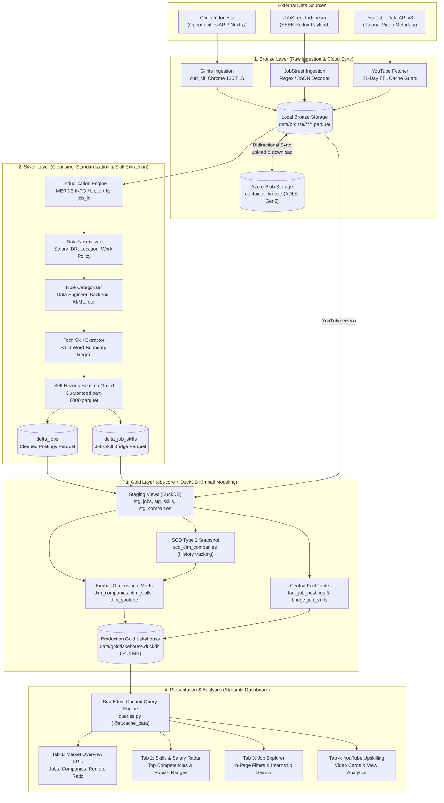

# JOSE (Job Seeks Era)
### Indonesian Tech Job Market & YouTube Learning Radar

[](https://github.com/Ferdyagustian/JOSE/actions/workflows/ci_quality.yml)
[](https://www.python.org/)
[](https://duckdb.org/)
[](https://www.getdbt.com/)
[](https://spark.apache.org/)
[](https://streamlit.io/)

A modern, serverless **Data Lakehouse** (Medallion Architecture: Bronze &rarr; Silver &rarr; Gold) engineered with the **Clean Philosophy** (lean, resilient, zero-overengineering, zero-burn cloud compute cost). JOSE tracks the Indonesian tech employment landscape from leading portals (Glints, JobStreet), extracts in-demand tech skills, maps them to curated YouTube tutorials, and visualizes them on a high-taste dark glassmorphism dashboard.

---

## 1. End-to-End Architecture & Data Flow



---

## 2. Detailed Data Flow Lifecycle

The diagram below details the journey of a job posting and its learning recommendations across the 4 stages of the Lakehouse:

### Step 1: Bronze Ingestion & Cold Storage Sync
1. **Scraping with Impersonation:** `GlintsScraper` and `JobStreetScraper` query active IT opportunities using `curl_cffi` with Chrome 120 browser TLS fingerprinting to bypass WAF challenges.
2. **Quota-Guarded YouTube Ingestion:** `YouTubeFetcher` retrieves curated tutorial metadata for tracked tech skills. A **21-day TTL cache guard** skips API calls if recent data exists, falling back to curated educational templates (FreeCodeCamp, Programming with Mosh) if API quotas are exhausted.
3. **Partitioned Bronze Parquet:** Raw records are saved to date-partitioned Parquet files:
   - `data/bronze/jobs/source={source}/dt={YYYY-MM-DD}/data.parquet`
   - `data/bronze/youtube/dt={YYYY-MM-DD}/videos.parquet`
4. **Cloud Mirroring:** If `AZURE_STORAGE_CONNECTION_STRING` is set, newly written files are automatically uploaded to Azure Blob container `bronze`, and missing historical partitions are downloaded onto runners.

### Step 2: Silver Cleansing & Competency Extraction
1. **Deduplication:** Jobs are deduplicated by `job_id` (upsert behavior), ensuring the latest posting attributes take precedence.
2. **Field Normalization:**
   - **Salaries:** Standardized to IDR monthly values (`salary_min_idr`, `salary_max_idr`) with NaN sanitization and currency conversion (USD/SGD to IDR).
   - **Work Policy:** Normalized into `Remote`, `Hybrid`, or `WFO`.
   - **Employment Type:** Classified into `Full-Time`, `Contract`, `Internship`, or `Part-Time`.
   - **Location:** Cleaned into `Indonesia, <City>` (e.g., `Indonesia, Jakarta`).
   - **Role Classification:** Rule-based regex categorizes titles into standard roles (*Data Engineer, Backend Engineer, Frontend / Fullstack, AI / ML Engineer, DevOps / Cloud, Mobile Developer, QA / Security*).
3. **Regex Word-Boundary Skill Extraction:** Text from job titles and descriptions is matched against the 50+ master skills catalog using strict word-boundary patterns (`\b(?i){skill}\b`) to eliminate false positives (*e.g., distinguishing "Go" from "Good", "C" from "CV/CEO"*).
4. **Self-Healing Schema Protection:** Parquet files (`data/silver/delta_jobs` and `data/silver/delta_job_skills`) are guaranteed to exist with full PyArrow schemas even if upstream scrapers encounter rate limits, preventing downstream model crashes.

### Step 3: Gold Kimball Modeling (dbt-core + DuckDB)
1. **Staging Layer:** Views (`stg_jobs`, `stg_job_skills`, `stg_companies`, `stg_youtube_videos`) cast clean datatypes and trim strings directly from Silver Parquet files via DuckDB's native `read_parquet()`.
2. **Slowly Changing Dimension (SCD Type 2):** `snapshots/scd_dim_companies.sql` uses dbt's check strategy to track historical company shifts (location, industry, remote policy changes) with `dbt_valid_from`, `dbt_valid_to`, and `is_current`.
3. **Star Schema Marts:**
   - `dim_companies`: Unique company dimension enriched with active job counts and remote-friendly flags.
   - `dim_skills`: Catalog of extracted technical skills categorized into programming languages, data engineering, cloud/devops, and frameworks.
   - `dim_youtube_videos`: Curated learning resources ranked by view count and engagement.
   - `fact_job_postings`: Transactional job posting grain with deterministic 32-character MD5 surrogate keys (`job_key`, `company_key`).
   - `bridge_job_skills`: Bridge table handling many-to-many relationships between job postings and technical skills.
4. **Database Consolidation:** All models compile directly into `data/gold/lakehouse.duckdb` (~4.4 MB), an embedded columnar analytical database.

### Step 4: Presentation & Analytics (Streamlit)
1. **Sub-50ms Cached Query Engine:** Analytical queries in `dashboard/queries.py` connect in read-only mode to `lakehouse.duckdb`, using `@st.cache_data` for rapid response times.
2. **Deep Obsidian Glassmorphism UI:** Built with custom vanilla CSS (`dashboard/styles.py`) featuring dark translucent cards, glowing accents, and Plotly visualizations.
3. **Responsive Job Explorer:** Features an in-page filtering toolbar with **Employment Type** filters (*Internship, Full-Time, Contract*) and live text search, ensuring smooth navigation on both mobile and desktop viewports.

---

## 3. Key Engineering Highlights

- **$0 Cloud Compute Cost:** Operates 100% within free-tier boundaries (GitHub Actions Ubuntu runner + local/Azure cold storage + DuckDB in-process engine + Streamlit Community Cloud).
- **Anti-Bot Resilient Ingestion:** Uses `curl_cffi` with Chrome 120 browser TLS fingerprint impersonation and circuit-breaker backoffs to prevent portal blocking.
- **Quota-Guarded YouTube Radar:** Integrates YouTube Data API v3 with a 21-day TTL parquet cache guard and resilient offline fallback templates ensuring 0 downtime even if quotas expire.
- **Tuned Single-Node PySpark:** Tuned for 7 GB memory runners (`spark.driver.memory="4g"`, `shuffle.partitions=4`) avoiding JVM Out-Of-Memory exceptions.
- **Strict Skill Extraction:** Regex word-boundary patterns (`\b(?i){skill}\b`) prevent false positives (e.g., distinguishing "Go" from "Good", "C" from "CV/CEO", with clean handling of "C++" and "C#").
- **Self-Healing Lakehouse Pipelines:** Baseline Lakehouse Parquet files are tracked in Git, ensuring fresh CI/CD runner instances or local clones run `dbt` and `pytest` with zero IO missing file errors.
- **Kimball Dimensional Modeling:**
  - `dim_companies`: Slowly Changing Dimension (SCD Type 2) tracking historical work policy and location updates.
  - `fact_job_postings`: Clean transaction grain with normalized Rupiah salaries (`Rp X - Y` or explicit `"Gaji tidak ditampilkan"`).
  - `bridge_job_skills`: Many-to-many relationship bridging postings and technical competencies.
- **Responsive In-Page Filter UI:** Immediate job exploration and filtering (Role, Work Policy, Employment Type including **Internship**, and keyword search) directly accessible on mobile and desktop viewports.

---

## 4. Repository Structure

```text
JOSE/
├── .github/workflows/
│   ├── ci_quality.yml           # Automated PR/Push tests (Ruff, Pytest, dbt compile)
│   └── daily_lakehouse_elt.yml  # Scheduled daily cron ELT pipeline (06:00 WIB)
├── .streamlit/
│   └── config.toml              # Streamlit Cloud dark theme & performance config
├── dashboard/
│   ├── __init__.py              # Dashboard package initialization
│   ├── app.py                   # Main Streamlit application
│   ├── queries.py               # Cached analytical DuckDB query engine (<50ms)
│   └── styles.py                # Deep Obsidian Glassmorphism CSS design system
├── data/
│   ├── bronze/                  # Partitioned raw ingestion Parquet files (seed & sync)
│   │   ├── jobs/                # Glints & JobStreet raw partitions
│   │   └── youtube/             # Curated YouTube tutorial raw partitions
│   ├── silver/                  # Cleaned Delta/Parquet normalized tables
│   │   ├── delta_jobs/          # Normalized jobs (part-0000.parquet)
│   │   └── delta_job_skills/    # Normalized skills bridge (part-0000.parquet)
│   └── gold/
│       └── lakehouse.duckdb     # Curated production Gold database (~4.4 MB)
├── dbt_lakehouse/
│   ├── models/                  # Staging and Star Schema dimensional models
│   ├── snapshots/               # SCD Type 2 snapshot for dim_companies
│   ├── dbt_project.yml          # dbt configuration
│   └── profiles.yml             # DuckDB adapter profile
├── infra/
│   ├── main.tf                  # Optional Terraform for Azure ADLS Gen2
│   ├── variables.tf
│   └── outputs.tf
├── src/
│   ├── config.py                # Master tech skills catalog & environment loader
│   ├── ingestion/               # Glints, JobStreet, YouTube, & Azure storage
│   └── spark_jobs/              # PySpark Silver cleaner & Skill extractor
├── tests/                       # 47 unit tests (100% green pass rate)
├── .env.example                 # Template for local environment variables
├── .gitignore                   # Clean rules (protects secrets, tracks baseline lakehouse)
├── pyproject.toml               # Ruff and Pytest tooling configuration
└── requirements.txt             # Project dependencies
```

---

## 5. Quickstart Guide

### Prerequisites
- Python **3.12+**
- Java **17+** (Required only for local PySpark execution)

### 1. Clone & Setup Virtual Environment
```bash
# Clone the repository
git clone https://github.com/Ferdyagustian/JOSE.git
cd JOSE

# Create and activate virtual environment
python -m venv .venv

# Windows PowerShell:
.\.venv\Scripts\Activate.ps1

# Linux / macOS:
source .venv/bin/activate

# Install dependencies
pip install --upgrade pip
pip install -r requirements.txt
```

### 2. Run the Streamlit Dashboard Locally
```bash
streamlit run dashboard/app.py
```
Open **[http://localhost:8501](http://localhost:8501)** in your browser. The dashboard reads directly from the pre-built Gold Lakehouse (`data/gold/lakehouse.duckdb`).

### 3. Run the Test Suite & Linter
```bash
# Run 47 unit tests across ingestion, transformations, dbt, and dashboard
pytest tests/ -v

# Run code linter
ruff check .
```

---

## 6. Running the Data Pipeline (ELT)

You can run each medallion stage individually:

```bash
# Stage 1: Bronze Ingestion (Glints, JobStreet, YouTube, & Azure sync)
python -m src.ingestion.pipeline

# Stage 2: Silver Normalization & Delta Merge (PySpark / DuckDB)
python -m src.spark_jobs.bronze_to_silver_jobs

# Stage 3: Gold Modeling & SCD Type 2 Snapshots (dbt)
dbt snapshot --project-dir dbt_lakehouse --profiles-dir dbt_lakehouse
dbt run --project-dir dbt_lakehouse --profiles-dir dbt_lakehouse
dbt test --project-dir dbt_lakehouse --profiles-dir dbt_lakehouse
```

---

## 7. Environment Configuration (`.env`)

Create a `.env` file in the project root (automatically ignored by `.gitignore`):

| Variable | Description | Default | Required |
|---|---|---|---|
| `AZURE_STORAGE_CONNECTION_STRING` | Azure Blob / ADLS Gen2 connection string | Empty (uses local disk) | Optional |
| `YOUTUBE_API_KEY` | Google Cloud YouTube Data API v3 key | Empty (uses cached fallback) | Optional |
| `ENVIRONMENT` | Runtime environment (`development` / `production`) | `development` | Optional |
| `LOCAL_DATA_DIR` | Local root directory for Lakehouse partitions | `./data` | Optional |
| `BRONZE_CONTAINER_NAME` | Container name for Bronze layer | `bronze` | Optional |

---

## 8. CI/CD & Deployment

- **GitHub Actions Quality Gate (`ci_quality.yml`):** Automatically tests and lints every pull request and push to `main` (Ruff, 47 Pytest tests, dbt compile).
- **Daily Automated Refresh (`daily_lakehouse_elt.yml`):** Runs daily at **06:00 WIB (23:00 UTC)**, pulls fresh postings, syncs with Azure Storage, updates models, and auto-commits the refreshed `lakehouse.duckdb` directly to GitHub.
- **Streamlit Community Cloud:** Connect `https://github.com/Ferdyagustian/JOSE` with main file path `dashboard/app.py` for free $0 hosting.

---

## 9. License

Distributed under the **MIT License**. See `LICENSE` for more information.
