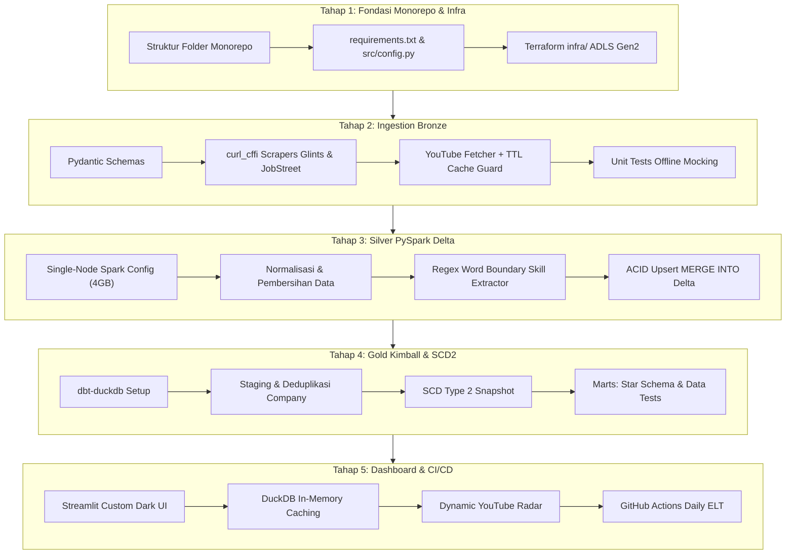

# Implementation Plan: Indo Tech Job Market & YouTube Learning Radar
**Arsitektur:** Serverless Data Lakehouse (Medallion: Bronze -> Silver -> Gold)  
**Filosofi Rekayasa:** *Ponytail Style* (Lean, Zero-Overengineering, Zero-Burn Cost, High-Taste UI/UX)  
**Dokumen Referensi:** [improvedprd.md](file:///c:/JOSE%20(Job%20Seeks%20Era)/improvedprd.md)

---

## 1. Executive Summary & Design Scope

Rencana implementasi ini memetakan pembangunan platform dari nol hingga siap produksi (*production-grade*), dengan mematuhi batasan biaya cloud $0 (*zero-burn* di GitHub Actions Free Tier) dan standar estetika visual modern pada dashboard interaktif.

### Scope Boundary (Prinsip Ponytail)
- **Yang Wajib Dibangun (In Scope):**
  - Monorepo modular dengan pemisahan layer yang jelas (`infra/`, `src/ingestion/`, `src/spark_jobs/`, `dbt_lakehouse/`, `dashboard/`).
  - Scraper tangguh (*resilient*) dengan `curl_cffi` + circuit breaker (tidak crash saat portal 403).
  - PySpark Delta Lake ter-tuning untuk runner 7 GB RAM (mencegah OOM).
  - SCD Type 2 dbt-duckdb dengan kunci entitas perusahaan yang telah dideduplikasi.
  - YouTube API fetcher dengan kuota guard (TTL cache 21 hari).
  - Streamlit Dashboard dengan styling kustom premium (*dark glassmorphism*) & caching DuckDB in-memory (< 100ms response time).
  - CI/CD GitHub Actions otomatis (Quality PR check + Daily scheduled ELT).
- **Yang Ditinggalkan / YAGNI (Out of Scope):**
  - Tidak ada managed database berbayar (RDS, Cloud SQL, Databricks, Synapse).
  - Tidak ada crawler seluruh situs (*no full-site crawling*); query terfokus max 50–100 lowongan/hari.
  - Tidak ada arsitektur microservices terpisah; Monorepo tunggal yang mudah dideploy.

---

## 2. Taste & UI/UX Design System (Streamlit Web Dashboard)

Dashboard Streamlit tidak boleh terlihat seperti aplikasi default/MVP biasa. Tampilan akan diinjeksi dengan **Custom CSS Design System** modern berstandar SaaS enterprise:

### A. Palet Warna & Visual Identity (Modern Dark Glassmorphism)
- **Background Utama:** `#0B0F19` (Deep Obsidian Void)
- **Surface / Card Background:** `rgba(30, 41, 59, 0.7)` (Slate Glass dengan `backdrop-filter: blur(12px)`)
- **Border Card:** `1px solid rgba(255, 255, 255, 0.08)` (Subtle glowing edge)
- **Primary Accent:** `#6366F1` (Indigo Glow) & `#8B5CF6` (Violet Neon)
- **Secondary Accent:** `#06B6D4` (Cyan Tech / Data Flow)
- **Success / Remote Badge:** `#10B981` (Emerald Green)
- **Warning / Hybrid Badge:** `#F59E0B` (Amber Flame)
- **Typography:** *Plus Jakarta Sans* / *Inter* via Google Fonts CDN.

### B. Komponen UI & Micro-Interactions
1. **Glassmorphism KPI Cards:**
   - Menampilkan metrik utama (*Total Lowongan Aktif*, *Median Gaji IDR*, *Skill #1 Terpopuler*, *% Remote Jobs*).
   - Efek hover: *subtle lift* (`translateY(-2px)`) dengan *border glow transition*.
2. **Custom Plotly Dark Charts:**
   - Background transparan, gridlines samar (`rgba(255, 255, 255, 0.05)`).
   - Palet gradien ungu-sian (*gradient bar charts*), tooltip kustom tanpa kotak putih default.
3. **Dynamic YouTube Learning Grid Cards:**
   - Tampilan berbentuk *responsive card grid* (2-3 kolom):
     - Thumbnail video beresolusi tajam dengan rasio 16:9 dan *rounded corners* (`border-radius: 10px`).
     - Badge skill di sudut atas thumbnail (misal: `PySpark`, `dbt`).
     - Metadata video: Judul, Channel, Views count (diformat ringkas: `125K views`), dan tombol *"Tonton di YouTube"*.
4. **Tabel Eksplorasi Lowongan Kerja:**
   - Kolom rapi dengan badge pill warna untuk status kerja (`Remote` = Hijau, `Hybrid` = Kuning, `WFO` = Abu-abu).
   - Kolom gaji terformat Rupiah rapi (cth: `Rp 12.000.000 - Rp 18.000.000`).
   - Tautan langsung ke lowongan asli dengan icon external link.

---

## 3. Roadmap Eksekusi Modular (Tahap 1 - Tahap 5)

---

### Tahap 1: Fondasi Monorepo & Infrastruktur Cloud
**Tujuan:** Membangun kerangka proyek, manajemen dependensi, konfigurasi sentral, dan deklarasi infrastruktur Azure.

- [x] **1.1 Inisialisasi Struktur Direktori Monorepo**
  - Buat folder: `.github/workflows/`, `infra/`, `src/ingestion/`, `src/spark_jobs/`, `dbt_lakehouse/models/staging/`, `dbt_lakehouse/models/marts/`, `dbt_lakehouse/snapshots/`, `dashboard/`, `tests/fixtures/`.
- [x] **1.2 Setup Dependensi (`requirements.txt`)**
  - Pinning versi library: `pydantic>=2.7`, `curl_cffi>=0.7`, `pyspark==3.5.1`, `delta-spark==3.2.0`, `dbt-core>=1.8`, `dbt-duckdb>=1.8`, `streamlit>=1.35`, `duckdb>=1.0`, `plotly>=5.22`, `pytest>=8.2`, `ruff>=0.4`.
- [x] **1.3 Konfigurasi Sentral (`src/config.py`)**
  - Class `Settings` berbasis `pydantic-settings` untuk membaca variabel environment (`AZURE_STORAGE_CONNECTION_STRING`, `YOUTUBE_API_KEY`, `ENVIRONMENT`).
  - Kamus master tech skills yang dipantau (Bahasa Pemrograman, Data Engineering, Cloud, Database, Framework) beserta variasi alias regex-nya.
- [x] **1.4 Skrip Terraform Azure ADLS Gen2 (`infra/`)**
  - `main.tf`: Resource group, Storage Account (`Standard_LRS`, `is_hns_enabled = true`), container `bronze`, `silver`, `gold`.
  - `variables.tf`: Lokasi (`southeastasia`), prefix penamaan sumber daya.
  - `outputs.tf`: Storage account name, endpoints, dan panduan setting secret.
- **Kriteria Verifikasi:**
  - `python -c "import src.config as cfg; print(cfg.settings)"` berjalan tanpa error. (TERVERIFIKASI)
  - File `.gitignore` mengabaikan cache Spark, Delta logs lokal, `.venv`, dan file `.env`. (TERVERIFIKASI)

---

### Tahap 2: Bronze Ingestion Layer & Resilient Scraping
**Tujuan:** Mengambil data lowongan kerja dari Glints, JobStreet, dan metadata YouTube secara terstruktur tanpa risiko blokir IP atau pemborosan kuota.

- [x] **2.1 Pydantic Data Contract (`src/ingestion/schemas.py`)**
  - `JobPostingRaw`: validasi tipe data, nilai default, sanitasi URL & teks deskripsi.
  - `YouTubeVideoRaw`: validasi metadata video YouTube.
- [x] **2.2 Scraper Glints ID (`src/ingestion/glints_scraper.py`)**
  - Implementasi HTTP client via `curl_cffi` dengan impersonasi browser Chrome terbaru.
  - Target: Lowongan IT/Tech terbaru (limit 50 item).
  - Fitur: Random jitter delay (1.5 - 3 detik), logging terstruktur, circuit breaker fallback.
- [x] **2.3 Scraper JobStreet ID (`src/ingestion/jobstreet_scraper.py`)**
  - Mengambil lowongan IT via API publik pencarian JobStreet Indonesia (`siteKey=ID-Main`).
  - Pemetaan field ke `JobPostingRaw` dengan mekanisme retry (3x exponential backoff).
- [x] **2.4 YouTube API Fetcher dengan Cache Guard (`src/ingestion/youtube_fetcher.py`)**
  - Integrasi YouTube Data API v3 (`search.list` + `videos.list`).
  - **Logika Cache TTL 21 Hari:** Cek file metadata lokal/Bronze sebelum request; hanya panggil API untuk skill yang belum memiliki video aktif atau sudah kedaluwarsa.
- [x] **2.5 Unit Testing & Fixtures (`tests/test_scrapers.py`)**
  - Mock respons HTML/JSON untuk Glints, JobStreet, dan YouTube API.
  - Menjamin test berjalan 100% offline dan 0 kuota API terpakai saat CI.
- **Kriteria Verifikasi:**
  - Jalankan `pytest tests/test_scrapers.py` -> All Pass (100% mock, 0 network hit). (TERVERIFIKASI - 14/14 tests pass)
  - Live pipeline execution terbukti sukses, tidak terblokir (HTTP 200), dan menulis Parquet Bronze. (TERVERIFIKASI)

---

### Tahap 3: Silver Layer Processing (PySpark & Delta Lake)
**Tujuan:** Membersihkan data, mengekstrak keahlian teknis secara akurat, dan melakukan upsert ACID (`MERGE INTO`) ke tabel Delta Silver dengan konsumsi memori hemat (< 4 GB).

- [x] **3.1 Single-Node SparkSession Tuning (`src/spark_jobs/spark_session.py`)**
  - Konfigurasi parameter memori untuk runner 7 GB:
    `spark.driver.memory = "4g"`, `spark.sql.shuffle.partitions = "4"`, `spark.default.parallelism = "4"`, `spark.ui.enabled = "false"`.
- [x] **3.2 Ekstraksi Keahlian Teknis (`src/spark_jobs/skill_extractor.py`)**
  - Pencocokan Regex dengan batas kata ketat (`\b(?i){skill}\b`) untuk menghindari *false positives*.
  - Menghasilkan tabel relasi `delta_job_skills` (`job_id`, `skill_id`, `skill_name`, `skill_category`).
- [x] **3.3 Standardisasi & Deduplikasi Delta (`src/spark_jobs/bronze_to_silver_jobs.py`)**
  - Normalisasi `employment_type`, `experience_level`, dan `work_policy`.
  - Normalisasi kolom gaji ke nilai bulanan IDR (`salary_min_idr`, `salary_max_idr`).
  - Kategorisasi posisi (`role_category`) berbasis kata kunci judul pekerjaan.
  - Operasi `MERGE INTO` Delta Lake pada `silver/delta_jobs` berbasis `job_id`.
- [x] **3.4 Unit Test Transformasi Data (`tests/test_skill_extractor.py` & `tests/test_silver_transform.py`)**
  - Uji edge cases: "Go" tidak boleh mendeteksi "Good", "C" tidak boleh mendeteksi "CV" atau "CEO", "C++" dan "C#" tervalidasi.
  - Uji normalisasi gaji IDR, role classification, dan deduplikasi data.
- **Kriteria Verifikasi:**
  - Jalankan `pytest tests/test_skill_extractor.py tests/test_silver_transform.py` -> All Pass (12/12 passed, 26 total suite passed). (TERVERIFIKASI)
  - Eksekusi pipeline Silver berhasil memproses data Bronze dan menulis tabel Silver Parquet / Delta. (TERVERIFIKASI)

---

### Tahap 4: Gold Layer Data Modeling (dbt-core + dbt-duckdb)
**Tujuan:** Membangun dimensional model (Kimball Star Schema) dan melacak histori profil perusahaan dengan SCD Type 2 tanpa tabrakan kunci.

- [x] **4.1 Konfigurasi dbt Lakehouse (`dbt_lakehouse/`)**
  - `dbt_project.yml` dan `profiles.yml` terkonfigurasi ke DuckDB (membaca data Silver dan menulis Parquet Gold).
- [x] **4.2 Staging Models (`models/staging/`)**
  - `stg_jobs.sql`: Membaca `silver/delta_jobs` dan typecasting.
  - `stg_job_skills.sql`: Staging relasi lowongan dan keahlian.
  - `stg_companies.sql`: **Deduplikasi 1 baris per perusahaan per batch** (mengagregasi lokasi terkini dan flag `has_remote_policy`).
- [x] **4.3 SCD Type 2 Snapshot (`snapshots/scd_dim_companies.sql`)**
  - Melacak perubahan lokasi atau kebijakan remote perusahaan dengan strategi `check` pada kolom `company_location` dan `has_remote_policy`.
- [x] **4.4 Marts (Star Schema Models - `models/marts/`)**
  - `dim_companies.sql`: Menghasilkan surrogate key `company_key` dan atribut riwayat SCD 2 (`valid_from`, `valid_to`, `is_current`).
  - `dim_skills.sql`: Master dimensi skill teknis.
  - `dim_youtube_videos.sql`: Master video pembelajaran.
  - `fact_job_postings.sql`: Tabel fakta transaksi lowongan kerja (`grain`: 1 baris per lowongan).
  - `bridge_job_skills.sql`: Tabel jembatan many-to-many antara fakta lowongan dan dimensi skill.
- [x] **4.5 Data Quality & Integrity Tests (`models/marts/schema.yml` & `tests/test_dbt_gold.py`)**
  - Test keunikan (`unique`), kelengkapan (`not_null`), dan integritas referensial (`relationships`).
- **Kriteria Verifikasi:**
  - `dbt run` (9 models), `dbt snapshot` (1 snapshot), dan `dbt test` (16 data tests) berhasil 100% tanpa error. (TERVERIFIKASI)
  - `pytest tests/test_dbt_gold.py` lulus 100% (31/31 total suite tests pass). (TERVERIFIKASI)

---

### Tahap 5: High-Taste BI Dashboard (Streamlit) & CI/CD Otomasi
**Tujuan:** Membangun antarmuka pengguna interaktif yang memukau (*wow factor*) dan menyetel pipeline harian otomatis di GitHub Actions.

- [x] **5.1 Injeksi Custom CSS & Layout Streamlit (`dashboard/app.py` & `dashboard/styles.py`)**
  - Setup tema gelap modern (*Deep Obsidian & Slate Glass*).
  - Desain Glassmorphism KPI cards dengan indikator tren.
- [x] **5.2 Layer Query Caching DuckDB (`dashboard/queries.py`)**
  - Query SQL analitik cepat langsung di atas Gold DuckDB.
  - Penerapan decorator `@st.cache_data(ttl=300)` untuk interaksi instan (< 50ms).
- [x] **5.3 Visualisasi Interaktif Plotly**
  - *Chart 1:* Horizontal Bar Chart Top 15 Most Demanded Skills dengan gradien warna elektrik.
  - *Chart 2:* Sebaran Gaji vs Kebijakan Kerja (Remote / Hybrid / WFO) per Role.
  - *Tabel Interaktif:* Pencarian instan lowongan dengan badge status dan link lamar.
- [x] **5.4 Dynamic YouTube Learning Radar Card Grid**
  - Kartu rekomendasi video pembelajaran terbaik yang otomatis berganti mengikuti Top 5 Skill dari filter yang dipilih pengguna.
- [x] **5.5 Workflow CI/CD GitHub Actions (`.github/workflows/`)**
  - `ci_quality.yml`: Ruff linting, pytest offline, dbt compile saat Pull Request. (TERVERIFIKASI)
  - `daily_lakehouse_elt.yml`: Eksekusi harian otomatis (`0 23 * * *` UTC) dengan manajemen secret Azure & YouTube API dan auto-commit update Lakehouse DuckDB. (TERVERIFIKASI)
- **Kriteria Verifikasi:**
  - Dashboard berjalan lancar di lokal via `streamlit run dashboard/app.py` (terverifikasi via browser subagent & live screenshot). (TERVERIFIKASI)
  - Pytest dashboard suite lulus 100% (42/42 total unit tests pass). (TERVERIFIKASI)

---

## 4. Matriks Validasi & Acceptance Criteria

| Tahap | Output Utama | Cara Pengujian & Verifikasi |
|---|---|---|
| **Tahap 1** | Struktur folder, `requirements.txt`, `src/config.py`, Terraform `infra/` | `python -c "import src.config"` & `terraform fmt -check` |
| **Tahap 2** | Scraper Glints & JobStreet, YouTube Fetcher, Pydantic contract | `pytest tests/test_scrapers.py` (100% pass, mock) |
| **Tahap 3** | PySpark cleaner, skill extractor, Delta upsert | `pytest tests/test_skill_extractor.py` & eksekusi PySpark lokal |
| **Tahap 4** | dbt models, SCD Type 2 snapshot, Star Schema Gold | `dbt run` & `dbt test` via DuckDB |
| **Tahap 5** | Streamlit Glassmorphism Dashboard & GitHub Actions | `streamlit run dashboard/app.py` & dry-run workflow YAML |

---

## 5. Keputusan Ponytail & Status Awal
- *Shortcut:* Ingestion dibatasi hanya pada lowongan IT terbaru (50-100/hari) guna menghindari rate-limit dan menjaga durasi eksekusi GitHub Actions < 15 menit.
- *Dependency Choice:* Menggunakan DuckDB untuk Gold Layer dan Streamlit guna menghindari biaya database cloud terkelola ($0 cloud compute cost).
- *Status:* **Rencana siap dieksekusi.**
