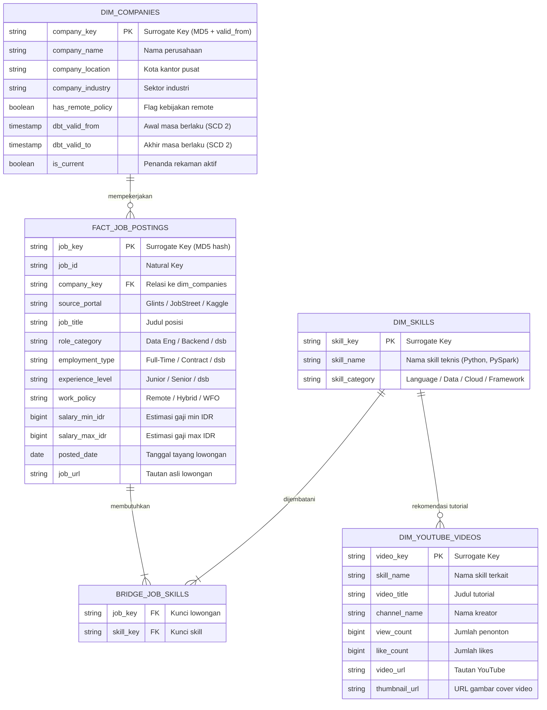

# Product Requirements Document (PRD) — Improved Production Edition
## Nama Proyek: Indo Tech Job Market & YouTube Learning Radar (Zero-Burn Serverless Lakehouse)

---

### 1. Ikhtisar & Tujuan Proyek
Proyek ini membangun **Serverless Data Lakehouse** *end-to-end* berstandar produksi (*production-grade*) dalam arsitektur **Monorepo**. 

Sistem ini dirancang untuk:
1. **Mengambil data harian** lowongan kerja IT di Indonesia dari **Glints** dan **JobStreet** secara otomatis tanpa memicu pemblokiran bot.
2. **Menggabungkan data historis** lowongan kerja (1 juta+ baris dari Kaggle) dengan data *stream* harian.
3. **Mengekstrak keahlian teknis (tech skills)** dari deskripsi pekerjaan menggunakan engine pemrosesan data teroptimasi (**PySpark**).
4. **Memodelkan data analitik** ke dalam **Kimball Star Schema** dan melacak perubahan atribut perusahaan melalui **SCD Type 2** menggunakan **dbt + DuckDB**.
5. **Memperkaya wawasan (enrichment)** dengan mengaitkan keahlian teknis paling dicari ke video tutorial kurasi terbaik melalui **YouTube Data API v3** (dengan penghematan kuota berbasis cache).
6. **Menyajikan analitik interaktif** melalui **Streamlit BI Dashboard** dengan performa tinggi berbasis *in-memory* DuckDB caching.

---

### 2. Batasan Utama & Prinsip Rekayasa (*Engineering Constraints*)
1. **Biaya Komputasi Cloud $0 (Zero-Burn Cloud Cost):**
   - Dilarang keras menggunakan Cloud VM berbayar (EC2/Azure VM), managed Spark (Databricks/Synapse/EMR), atau managed SQL database (RDS/Azure SQL).
   - Seluruh pemrosesan data (Scraping, PySpark, dbt-DuckDB, pengujian) wajib berjalan secara *ephemeral* di **GitHub Actions Free Tier (Ubuntu runner: 2 vCPU, 7 GB RAM)** atau komputer lokal developer.
   - Layanan Cloud hanya diperbolehkan untuk penyimpanan objek: **Azure Blob Storage (ADLS Gen2)** dengan tier `Hot/Cool Standard_LRS` (estimasi ukuran total Parquet/Delta < 500 MB, biaya riil < $0.02/bulan).
2. **Anti-Scraping & Resilient Ingestion:**
   - Dilarang memindai seluruh web (*no full-site crawling*). Hanya memfilter **Lokasi = Indonesia**, **Kategori = IT/Software/Data**, dan **Urutan = Terbaru / 24 Jam Terakhir** (kuota aman 50–100 lowongan per sumber per hari).
   - Ingestion dilengkapi *circuit breaker*: kegagalan HTTP 403/Cloudflare challenge pada satu sumber tidak boleh mematikan pipeline; sistem mencatat *warning* dan melanjutkan dengan data yang berhasil didapatkan.
3. **Pencegahan OOM & Spark Single-Node Tuning:**
   - Karena runner GitHub Actions hanya memiliki 7 GB RAM, PySpark **wajib dituning** khusus untuk single-node (`shuffle.partitions=4`, driver memory 4GB). Dataset historis 1 juta baris di-seed ke Bronze/Silver secara terpisah (skrip satu kali), tidak di-remerge mentah-mentah setiap hari.
4. **Logika SCD Type 2 yang Benar (No Natural Key Collision):**
   - `work_policy` (Remote, Hybrid, WFO) ditempatkan pada level lowongan (`fact_job_postings`), bukan mutlak pada dimensi perusahaan (`dim_companies`), karena satu perusahaan dapat membuka pekerjaan Remote dan WFO sekaligus.
   - `scd_dim_companies` hanya melacak atribut tingkat entitas perusahaan yang telah dideduplikasi (1 baris per `company_name` per run batch), seperti lokasi kantor pusat (`company_location`), industri (`company_industry`), dan profil kebijakan agregat perusahaan (`has_remote_policy`).
5. **Pencegahan Kebocoran Kuota YouTube API:**
   - Pemanggilan YouTube API dibatasi kuota gratis harian (10.000 unit/hari; 1 search = 100 unit). Diberlakukan cache TTL (14–30 hari per skill); data video yang masih valid tidak dipanggil ulang. Pengujian unit test wajib menggunakan data *mock* (0 pemanggilan API keluar saat CI).
6. **Pola Arsitektur:** Medallion Architecture (**Bronze -> Silver -> Gold**) di dalam satu repositori (**Monorepo**).

---

### 3. Tech Stack & Pustaka

| Kategori | Komponen / Pustaka | Rationale & Justifikasi Teknis |
|---|---|---|
| **Bahasa & Runtime** | Python 3.11+, OpenJDK 11/17 (untuk Spark) | Standar industri untuk Data & Platform Engineering. |
| **Infrastruktur (IaC)** | Terraform (provider `azurerm`) | Deklaratif, idempotent, mempermudah reproduksi ADLS Gen2 dan container. |
| **Ingestion & Scraping** | `curl_cffi`, `pydantic v2`, Google API Client | `curl_cffi` menyamarkan TLS fingerprint (bypass basic bot protection); Pydantic menjamin *data contract*. |
| **Penyimpanan Objek** | Azure Blob Storage (ADLS Gen2) | Kompatibel dengan protokol ABFS/Parquet/Delta, biaya penyimpanan sangat murah. |
| **Big Data Engine (Silver)** | `pyspark==3.5.*`, `delta-spark==3.2.*` | Standar industri untuk ACID transactions, deduplikasi upsert (`MERGE INTO`), dan ekstraksi skill. |
| **Warehouse & Modeling (Gold)** | `dbt-core==1.8.*`, `dbt-duckdb==1.8.*` | Transformasi SQL Kimball Star Schema & SCD Type 2 secara serverless tanpa server database aktif. |
| **BI & Visualisasi** | `streamlit`, `duckdb` (in-memory), `plotly` | Dashboard interaktif cepat, membaca Gold Parquet dengan caching lokal. |
| **Orkestrasi & CI/CD** | GitHub Actions (Cron schedule: `0 23 * * *` UTC / 06:00 WIB) | Zero-cost serverless execution engine harian. |
| **Quality & Tests** | `pytest`, `pytest-mock`, `ruff`, `dbt test` | Linter ketat, uji scraper, ekstraktor skill, dan pengujian keunikan/referensial dbt. |

---

### 4. Struktur Direktori Monorepo

```text
indo-tech-job-radar/
├── .github/
│   └── workflows/
│       ├── ci_quality.yml             # Ruff check/format, pytest (dengan mock), dbt compile test
│       └── daily_lakehouse_elt.yml    # Pipeline harian: Scrape -> PySpark Delta -> dbt-duckdb -> Gold
├── infra/
│   ├── main.tf                        # Azure Resource Group, Storage Account (ADLS Gen2), Containers
│   ├── variables.tf                   # Konfigurasi lokasi wilayah (Southeast Asia), nama prefix
│   └── outputs.tf                     # Storage account name, container endpoints, panduan connection string
├── src/
│   ├── __init__.py
│   ├── config.py                      # Konfigurasi environment (Pydantic Settings), skill dictionary
│   ├── ingestion/
│   │   ├── __init__.py
│   │   ├── schemas.py                 # Pydantic models (JobPostingRaw, YouTubeVideoRaw)
│   │   ├── glints_scraper.py          # Scraper API/GraphQL Glints ID via curl_cffi + circuit breaker
│   │   ├── jobstreet_scraper.py       # Scraper API publik JobStreet ID via curl_cffi + retry logic
│   │   ├── youtube_fetcher.py         # YouTube API v3 fetcher dengan cache TTL & rate limiter
│   │   └── kaggle_seed_loader.py      # Script one-off: memuat dataset historis ke Bronze/Silver
│   └── spark_jobs/
│       ├── __init__.py
│       ├── spark_session.py           # SparkSession builder ter-tuning (driver 4GB, shuffle 4)
│       ├── bronze_to_silver_jobs.py   # Pembersihan, normalisasi kategori, deduplikasi MERGE INTO Delta
│       └── skill_extractor.py         # Ekstraktor Regex batas kata (*word boundary*) untuk tech skills
├── dbt_lakehouse/
│   ├── dbt_project.yml
│   ├── profiles.yml                   # Koneksi DuckDB ke Gold layer (memori lokal / Azure Parquet)
│   ├── models/
│   │   ├── staging/
│   │   │   ├── stg_jobs.sql           # Read silver delta / parquet & typecasting
│   │   │   ├── stg_job_skills.sql     # Staging relasi lowongan & skill
│   │   │   └── stg_youtube_videos.sql # Staging metadata video youtube
│   │   └── marts/
│   │       ├── schema.yml             # Data tests: unique, not_null, accepted_values, relationships
│   │       ├── dim_companies.sql      # Dimensi perusahaan (berisi surrogate key & profil)
│   │       ├── dim_skills.sql         # Dimensi skill (skill_key, name, category)
│   │       ├── dim_youtube_videos.sql # Dimensi video tutorial pembelajaran
│   │       ├── fact_job_postings.sql  # Fakta lowongan kerja (grain: 1 baris per job posting)
│   │       └── bridge_job_skills.sql  # Bridge table M:N antara fact_job_postings & dim_skills
│   └── snapshots/
│       └── scd_dim_companies.sql      # SCD Type 2 snapshot (melacak perubahan lokasi & profil perusahaan)
├── dashboard/
│   ├── app.py                         # Streamlit UI interaktif dengan in-memory DuckDB caching
│   └── queries.py                     # Koleksi query DuckDB SQL analitik untuk widget & grafik
├── tests/
│   ├── conftest.py                    # Fixture & mock payload Glints, JobStreet, YouTube API
│   ├── test_scrapers.py               # Unit test ingestion & skema validasi Pydantic
│   ├── test_skill_extractor.py        # Unit test ketepatan deteksi skill dari deskripsi kerja
│   └── test_spark_transform.py        # Unit test normalisasi kolom & deduplikasi
├── requirements.txt                   # Pinning versi library produksi
└── README.md                          # Dokumentasi arsitektur, panduan setup lokal & deployment
```

---

### 5. Spesifikasi Fungsional per Tahapan Pipeline

#### Tahap 1: Infrastruktur (*IaC - `infra/`*)
- Menggunakan Terraform (`provider "azurerm"`) untuk membuat:
  1. Resource Group (misal: `rg-job-radar-prod`, region `SoutheastAsia`).
  2. Storage Account berfitur Hierarchical Namespace (`is_hns_enabled = true` untuk ADLS Gen2), SKU `Standard_LRS`, Access Tier `Hot`.
  3. Tiga Blob Container: `bronze` (data mentah), `silver` (Delta tables terkurasi), `gold` (Star Schema Parquet untuk analitik).
- Output: Nama Storage Account, Primary Access Key / Connection String (disiapkan untuk dimasukkan ke GitHub Secrets: `AZURE_STORAGE_CONNECTION_STRING`).

#### Tahap 2: Bronze Layer — Data Ingestion (*`src/ingestion/`*)
1. **Pydantic Data Contracts (`schemas.py`):**
   - Mendefinisikan schema ketat untuk data mentah: `JobPostingRaw` dan `YouTubeVideoRaw`.
   - Menjamin bahwa data dari Glints dan JobStreet dipetakan ke atribut yang identik sebelum disimpan.
2. **Glints Scraper (`glints_scraper.py`):**
   - Mengambil data melalui endpoint GraphQL / REST publik Glints Indonesia.
   - Filter ketat: Lokasi Indonesia, kategori IT/Software, diurutkan terbaru (50–100 lowongan per run).
   - Menggunakan `curl_cffi` dengan browser impersonation, User-Agent acak, dan jitter delay (1.5 - 3.5 detik).
   - Mengisi kolom: `job_id`, `source` (`'glints'`), `job_title`, `company_name`, `company_industry`, `company_location`, `employment_type`, `work_policy`, `experience_level`, `salary_min`, `salary_max`, `currency`, `job_description`, `job_url`, `posted_at`, `scraped_at`.
3. **JobStreet Scraper (`jobstreet_scraper.py`):**
   - Mengambil data melalui API publik JobStreet Indonesia (`siteKey=ID-Main`, klasifikasi = Computer / Information Technology).
   - Memetakan field ke format `JobPostingRaw`.
   - Mengimplementasikan *retry mechanism* (maksimal 3 kali dengan *exponential backoff*).
4. **YouTube Fetcher dengan Quota Guard (`youtube_fetcher.py`):**
   - Membaca daftar *monitored skills* dari `src/config.py` (contoh: Python, SQL, PySpark, dbt, Airflow, Docker, Kubernetes, Golang, React, Kafka, FastAPI, TensorFlow).
   - **Logika Cache Guard:** Sebelum memanggil API, periksa apakah data video untuk skill tersebut sudah ada dan berumur kurang dari 21 hari. Jika ya, *skip* pemanggilan API untuk menghemat kuota.
   - Untuk skill yang membutuhkan data baru: Ambil 5 video tutorial teratas via YouTube Data API v3 (`video_id`, `skill_name`, `video_title`, `channel_name`, `view_count`, `like_count`, `published_at`, `video_url`, `thumbnail_url`).
5. **Kaggle Historical Seed Loader (`kaggle_seed_loader.py`):**
   - Skrip khusus satu kali jalan (*one-off*) untuk mengunduh/memproses dataset lowongan historis (1M+ baris), memetakan skemanya, dan menyimpannya langsung ke Bronze / Silver awal.
6. **Penyimpanan Bronze:**
   - Format: Parquet terpartisi berdasarkan tanggal dan sumber:
     `bronze/jobs/source={glints|jobstreet}/dt=YYYY-MM-DD/data.parquet`
     `bronze/youtube/dt=YYYY-MM-DD/videos.parquet`

#### Tahap 3: Silver Layer — PySpark & Delta Lake (*`src/spark_jobs/`*)
1. **Konfigurasi Engine Spark (`spark_session.py`):**
   - Disesuaikan khusus untuk batasan 7 GB RAM runner GitHub Actions:
     ```python
     def get_spark_session(app_name="JobRadarSilver"):
         return (
             SparkSession.builder
             .appName(app_name)
             .config("spark.driver.memory", "4g")
             .config("spark.executor.memory", "2g")
             .config("spark.sql.shuffle.partitions", "4")
             .config("spark.default.parallelism", "4")
             .config("spark.sql.extensions", "io.delta.sql.DeltaSparkSessionExtension")
             .config("spark.sql.catalog.spark_catalog", "org.apache.spark.sql.delta.catalog.DeltaCatalog")
             .config("spark.delta.logStore.class", "org.apache.spark.sql.delta.storage.S3SingleDriverLogStore") # atau Azure Native
             .getOrCreate()
         )
     ```
2. **Pembersihan & Standardisasi Data (`bronze_to_silver_jobs.py`):**
   - **Normalisasi Employment Type:** dipetakan ke `['Internship', 'Full-Time', 'Contract', 'Part-Time', 'Other']`.
   - **Normalisasi Experience Level:** dipetakan ke `['Fresh Graduate / Entry', 'Junior (1-3 yrs)', 'Mid-Senior (3-5 yrs)', 'Senior (5+ yrs)', 'Unspecified']`.
   - **Normalisasi Work Policy:** dipetakan ke `['Remote', 'Hybrid', 'WFO', 'Unspecified']`.
   - **Klasifikasi Role Category:** Menggunakan aturan berbasis kata kunci judul pekerjaan:
     - *Data Engineer*, *Data Analyst / Scientist*, *Backend Engineer*, *Frontend / Fullstack*, *AI / ML Engineer*, *DevOps / Cloud*, *Mobile Developer*, *QA / Security*, *Other IT*.
   - **Konversi Gaji:** Normalisasi rentang gaji ke mata uang IDR bulanan (`salary_min_idr`, `salary_max_idr`).
   - **Deduplikasi & Upsert ACID:**
     Menggunakan `MERGE INTO` Delta Lake pada target `silver/delta_jobs` berdasarkan `target.job_id = source.job_id`. Jika ada perubahan atribut gaji/status, lakukan `UPDATE`; jika baru, lakukan `INSERT`.
3. **Ekstraksi Keahlian Teknis (`skill_extractor.py`):**
   - Mengekstrak skill teknis dari `job_description` menggunakan pencocokan batas kata Regex (`\b(?i){skill}\b`) untuk menghindari *false positive* (misal: "Go" tidak boleh mencocokkan kata "Good" atau "Going").
   - Menghubungkan setiap lowongan dengan skill yang terdeteksi dan menyimpannya ke tabel Delta `silver/delta_job_skills` (`job_id`, `skill_id`, `skill_name`, `skill_category`).

#### Tahap 4: Gold Layer — Kimball Star Schema & SCD Type 2 (*`dbt_lakehouse/`*)
Transformasi Gold dijalankan oleh `dbt-core` dengan adapter `dbt-duckdb`. DuckDB membaca data Silver dan menghasilkan model Gold dalam format Parquet terindeks.

1. **Deduplikasi Entitas Perusahaan untuk Snapshot (`stg_companies`):**
   - Sebelum menjalankan snapshot SCD Type 2, lakukan agregasi data perusahaan dari batch harian sehingga hanya terdapat **1 baris per `company_name`**:
     - `company_name` (Kunci Alami)
     - `company_location` (Lokasi terkini)
     - `company_industry` (Industri terkini)
     - `has_remote_policy` (Boolean: true jika ada lowongan berstatus Remote/Hybrid)
     - `total_active_jobs` (Jumlah lowongan aktif saat ini)
2. **SCD Type 2 Snapshot (`snapshots/scd_dim_companies.sql`):**
   - Melacak perubahan lokasi atau kebijakan kerja perusahaan dari waktu ke waktu.
   - Kolom hasil dbt snapshot: `company_name`, `company_location`, `has_remote_policy`, `dbt_valid_from`, `dbt_valid_to`, `dbt_scd_id`.
3. **Model Dimensi & Fakta (Marts):**
   - **`dim_companies.sql`:** 
     Menghasilkan `company_key` (*MD5 surrogate key* dari `company_name` + `dbt_valid_from`), `company_name`, `company_location`, `has_remote_policy`, `is_current` (`dbt_valid_to IS NULL`).
   - **`dim_skills.sql`:** 
     Daftar master skill teknis (`skill_key`, `skill_name`, `skill_category`).
   - **`dim_youtube_videos.sql`:** 
     Daftar rekomendasi video (`video_key`, `skill_name`, `video_title`, `channel_name`, `view_count`, `like_count`, `video_url`, `thumbnail_url`).
   - **`fact_job_postings.sql`:** 
     Tabel fakta pusat (`job_key`, `job_id`, `company_key`, `source_portal`, `job_title`, `role_category`, `employment_type`, `experience_level`, `work_policy`, `salary_min_idr`, `salary_max_idr`, `posted_date`, `job_url`).
   - **`bridge_job_skills.sql`:** 
     Tabel jembatan *Many-to-Many* (`job_key`, `skill_key`).
4. **Data Quality Tests (`marts/schema.yml`):**
   - Uji integritas data: `unique` & `not_null` pada setiap *surrogate key*.
   - Uji referensial: `relationships` dari `fact_job_postings.company_key` ke `dim_companies.company_key`, serta `bridge_job_skills` ke `dim_skills` dan `fact_job_postings`.

#### Tahap 5: Interactive BI Dashboard (*`dashboard/app.py`*)
Aplikasi web Streamlit yang ringan dan responsif dengan arsitektur *read-only caching*:
1. **Koneksi Data Caching:**
   - Membaca file Gold Parquet dari Azure / disk lokal melalui DuckDB *in-memory*.
   - Menggunakan `@st.cache_data(ttl=3600)` sehingga interaksi filter tidak mengulang pembacaan remote storage.
2. **Filter Interaktif di Sidebar:**
   - Portal Sumber (Glints, JobStreet, Historical).
   - Kategori Role (Data Engineer, Backend, AI/ML, dll.).
   - Tipe Pekerjaan & Level Pengalaman.
   - Kebijakan Kerja (Remote, Hybrid, WFO).
   - Slider Rentang Gaji (IDR) & Filter Lokasi Provinsi/Kota.
3. **Visualisasi & Komponen Analitik:**
   - **Metrik Ringkasan (KPI Cards):** Total Lowongan Aktif, Median Gaji Nasional (IDR), Persentase Lowongan Remote, Skill #1 Paling Diminati.
   - **Grafik 1 (Skill Demand Radar):** Bar chart horizontal interaktif Plotly: *Top 15 Most Demanded Skills* sesuai filter aktif.
   - **Grafik 2 (Salary & Work Policy Distribution):** Boxplot / Bar chart perbandingan sebaran gaji berdasarkan kategori posisi dan kebijakan kerja (Remote vs Hybrid vs WFO).
   - **Tabel Eksplorasi Lowongan:** Tabel interaktif dengan fitur pencarian teks bebas, sortir gaji, dan tombol langsung *"Lamar Pekerjaan"*.
   - **Dynamic YouTube Learning Hub:** Menampilkan kartu video rekomendasi (thumbnail, judul, channel, viewer) yang secara dinamis menyesuaikan dengan **Top 5 Skill** dari filter yang sedang dipilih user.

#### Tahap 6: CI/CD & Automasi (*`.github/workflows/`*)
1. **`ci_quality.yml` (Pull Request Workflow):**
   - Menjalankan `ruff check` dan `ruff format --check`.
   - Menjalankan `pytest tests/` (seluruh scraper dan API di-mock, 100% offline).
   - Menjalankan validasi kompilasi dbt: `dbt compile --profiles-dir .`.
2. **`daily_lakehouse_elt.yml` (Scheduled Pipeline):**
   - Berjalan terjadwal setiap hari pada `0 23 * * *` UTC (06:00 WIB).
   - Mengatur environment Java 17 + Python 3.11.
   - Menjalankan scraping (Glints + JobStreet + YouTube API guard) -> simpan Parquet ke `bronze`.
   - Menjalankan PySpark job -> standardisasi & MERGE Delta ke `silver`.
   - Menjalankan dbt-duckdb snapshot & run -> simpan Parquet ke `gold`.
   - Mengirim notifikasi ringkasan eksekusi (*status badge* / GitHub step summary).

---

### 6. Skema Data & Relasi (Kimball Star Schema)



---

### 7. Matriks Manajemen Risiko Produksi (*Production Guardrails*)

| Potensi Kegagalan | Akar Masalah | Solusi & Guardrail Terpasang |
|---|---|---|
| **OOM Runner GitHub Actions (137)** | PySpark default mempartisi shuffle 200 dan memakan RAM > 7 GB. | Set `spark.sql.shuffle.partitions=4`, driver memory 4GB, matikan UI Spark (`spark.ui.enabled=false`). |
| **Glints/JobStreet Memblokir IP (403)** | IP runner Microsoft Azure diblokir oleh anti-bot WAF. | Gunakan `curl_cffi` dengan TLS fingerprint Chrome, sertakan circuit breaker (pipeline tidak boleh crash total jika 1 portal gagal). |
| **SCD Type 2 Gagal (Collision Key)** | Perusahaan memiliki banyak lowongan dengan kebijakan berbeda pada hari yang sama. | Pindahkan `work_policy` ke tabel fakta, deduplikasi perusahaan di staging menjadi 1 baris agregat per nama perusahaan sebelum snapshot. |
| **YouTube API Quota Habis (403)** | `search.list` menghabiskan 100 unit per skill; kuota gratis hanya 10.000 unit/hari. | Terapkan cache TTL 21 hari (hanya fetch video untuk skill baru), gunakan mock total saat test CI. |
| **Latensi Dashboard Streamlit Lambat** | Querying remote Azure Blob Storage berkali-kali setiap pergantian widget. | Terapkan caching DuckDB in-memory `@st.cache_data(ttl=3600)` pada layer presentasi. |

---

### 8. Rencana Eksekusi Bertahap (Instruksi Langkah Kerja)

AI Agent dan Developer wajib mengerjakan proyek ini secara teratur mengikuti tahapan modular berikut, dengan konfirmasi penyelesaian pada setiap tahap:

- **Tahap 1: Fondasi Monorepo & Infrastruktur Cloud**
  - Buat struktur direktori lengkap sesuai spesifikasi.
  - Buat `requirements.txt` (terkunci versinya) dan `src/config.py`.
  - Buat skrip Terraform `infra/` (`main.tf`, `variables.tf`, `outputs.tf`) untuk Azure Storage Account (ADLS Gen2) dan 3 container (`bronze`, `silver`, `gold`).
- **Tahap 2: Bronze Ingestion Layer & Pengujian Unit**
  - Implementasikan `src/ingestion/schemas.py` (Pydantic v2).
  - Implementasikan `glints_scraper.py` dan `jobstreet_scraper.py` (menggunakan `curl_cffi` + circuit breaker).
  - Implementasikan `youtube_fetcher.py` (dengan logic cache guard).
  - Buat unit test di `tests/test_scrapers.py` dengan mock payload JSON lokal.
- **Tahap 3: Silver Layer PySpark & Ekstraksi Skill**
  - Buat builder Spark teroptimasi di `src/spark_jobs/spark_session.py`.
  - Implementasikan `src/spark_jobs/skill_extractor.py` dengan regex batas kata aman.
  - Implementasikan `src/spark_jobs/bronze_to_silver_jobs.py` (normalisasi dan upsert `MERGE INTO` Delta Lake).
  - Buat unit test transformasi data di `tests/test_skill_extractor.py`.
- **Tahap 4: Gold Layer Data Modeling (dbt + DuckDB)**
  - Inisialisasi proyek dbt di `dbt_lakehouse/`.
  - Konfigurasi `dbt_project.yml` dan `profiles.yml` untuk konektor DuckDB.
  - Buat model staging, snapshot SCD Type 2 `scd_dim_companies.sql`, dan model dimensi/fakta mart.
  - Definisikan data quality tests di `schema.yml` dan verifikasi dengan `dbt test`.
- **Tahap 5: Streamlit BI Dashboard & CI/CD Otomatis**
  - Bangun `dashboard/app.py` dan `dashboard/queries.py` dengan DuckDB in-memory caching dan visualisasi Plotly.
  - Buat GitHub Actions workflows: `.github/workflows/ci_quality.yml` dan `.github/workflows/daily_lakehouse_elt.yml`.
  - Lengkapi `README.md` dengan instruksi instalasi lokal, diagram alur data, dan panduan environment secret.
